# Lipika

Lipika is a multi-source, multi-observer RF propagation simulator.

Lipika consumes `toml` configuration files describing transmitters and receivers 
along with their trajectories. For each receiver IQ data is generated for each 
transmitter, combining the relevant transmitters and modelling environmental effects
such as free space loss and receiver clock noise.

Lipika keeps transmitter signal representation in algebraic form as long as possible,
allowing each receive clock to sample the signal continuously.
This allows effects such as doppler shift to emerge naturally from sampling and
allows advanced modelling of clock noise effects.

📐 **[SIGNAL_MODEL.md](SIGNAL_MODEL.md)** — the algebra of the chain: the
transmitter `s(t)`, the emission-time / Sagnac propagation, the receiver operator
stack (antenna, oscillator δ(t)+LO, gain, IP3, the ADC collapse), and the full
forward formula `x[n] = Q(clip(Σ …))` with every term discussed. Equations **(E1)–
(E10)** each cite the function that implements them, and a §8 map ties the two
directions together (`grep -rn SIGNAL_MODEL src/` walks code → maths).

---

## Quick start

```bash
cd lipika
cargo build --release

cargo run --release --bin lipika -- \
    --config examples/dual_band.toml \
    --output ./out/ \
    --seed 2026
```

This streams one file per receiver-band into `./out/`:

- `<receiver>__<band>.iq.c64` — raw little-endian `complex64` (interleaved f32
  real, f32 imag), no header.
- `<receiver>__<band>.iq.json` — a metadata sidecar (epoch, sample rate, LO,
  sample count) plus a `descriptor` block capturing which transmitters (and, for
  GNSS, which PRNs) landed in the band and the full scene config used.

Load the IQ anywhere:

```python
import numpy as np
iq = np.fromfile("out/glasgow__gnss_l1.iq.c64", dtype=np.complex64)
```

### CLI options

| flag | default | meaning |
|---|---|---|
| `--config <path>` | — | TOML scene description |
| `--output <dir>` | — | output directory |
| `--seed <u64>` | `0` | seed for clock/noise RNG derivation |
| `--chunk-samples <n>` | `1048576` | streaming chunk size (controls memory) |
| `--threads <n>` | `0` (all cores) | workers for the per-chunk transmitter fan-out |
| `--profile` | off | print a per-section CPU profile at the end |

---

## How it works

The core idea is **time-domain Doppler via emission-time lookup**, not
frequency-shifting. For every output sample taken at receiver-time `t`, we solve
for the source's *emission time* `t_emit`:

```
t_emit + |P_src(t_emit) − P_obs(t)| / c = t
```

(a Newton fixed-point iteration), evaluate the source's signal at `t_emit`, and
mix it to the receiver's baseband. Carrier Doppler, chip-rate Doppler,
sample-rate skew between receivers, and code-phase walk all fall out of this one
mechanism — there is no separate "apply a Doppler shift" step that could drift
out of sync with the geometry. The solve includes the Earth-rotation (Sagnac)
correction — the source is rotated into the reception-time ECEF frame over the
transit — so the modelled delay is the true inertial light-travel time, faithful
to picoseconds (the rest matters for a timing reference: ~tens of ns otherwise).

Two design choices make this clean:

**Signals are algebraic, not buffers.** Every signal model is a function
`s(t) → complex` you can evaluate at any time, never a pre-sampled array. That
makes clock-relative re-interpolation trivial (just call `s` at the corrected
time) and avoids resampling artefacts.

**Carrier phase is computed from absolute geometry in f64, never accumulated.**
The phase at sample *n* is a function of the range and clock offset at *n*, so
phase error is bounded and does not grow with run length — important for the
long, coherent observations this is built for.

---

## Scene format

A scene has two top-level entry types: `[[transmitter]]` (an emitter) and
`[[receiver]]` (an observer). Each transmitter emits one signal at one carrier
from one trajectory; a physical platform with two emissions is modelled as two
transmitters sharing a trajectory. Each receiver has one trajectory, one clock,
and one or more `[[receiver.band]]` RF chains — **all bands share the
receiver's single clock**, so one OCXO drives every chain coherently, as in real
hardware.

```toml
[scene]
epoch_unix = 1717260840.0
duration_s = 120.0

[[transmitter]]
name = "iss_uhf_beacon"
carrier_hz = 437_000_000.0
tx_power_dbw = 0.0        # EIRP in dBW; 0 dBW = 1 W (default)
kind = "bpsk"
bit_rate_bps = 9600.0
sync_word = [-1, 1, 1, -1, 1, -1, -1, 1]
payload_bits = 287968
payload_seed = 2026
trajectory = { kind = "tle", line1 = "...", line2 = "..." }

[[transmitter]]
name = "gps_prn01"
carrier_hz = 1_575_420_000.0
tx_power_dbw = 27.0       # ~500 W EIRP, ≈ real GPS L1
kind = "ca_code"
prn = 1
epoch_unix = 1717260840.0
trajectory = { kind = "circular_keplerian", semi_major_axis_m = 26_578_137.0,
               inclination_deg = 55.0, raan_deg = 0.0,
               true_anomaly_deg_at_epoch = 30.0, epoch_unix = 1717260840.0 }

[[receiver]]
name = "glasgow"
trajectory = { kind = "stationary_geodetic", lat_deg = 55.86, lon_deg = -4.25, h_m = 10.0 }
clock = { allan_deviation_1s = 1e-11, frequency_offset_y0 = 0.5e-6, initial_time_offset_s = 0.0 }
[[receiver.band]]
band_id = "uhf_obs"
lo_carrier_hz = 437_000_000.0
sample_rate_hz = 48_000.0
noise_temperature_k = 290.0
[[receiver.band]]
band_id = "gnss_l1"
lo_carrier_hz = 1_575_420_000.0
sample_rate_hz = 2_048_000.0
noise_temperature_k = 290.0
```

Runnable examples live in [`examples/`](examples/):
[`iss_uhf_pass.toml`](examples/iss_uhf_pass.toml) (a single UHF beacon seen by
four UK receivers) and
[`dual_band.toml`](examples/dual_band.toml) (a UHF beacon plus six synthetic
GPS-like satellites, observed on two bands off one clock).

### Signal models

Each transmitter's `kind` selects an algebraic model:

| kind | algebraic form | notes |
|---|---|---|
| `cw` | `exp(j·2π·f_offset·t)` | single tone |
| `bpsk` | `bits[⌊(t − epoch)·bit_rate⌋]` | sync word + pseudo-random payload |
| `ca_code` | `chips[⌊(t − epoch)·1.023e6⌋ mod 1023]` | GPS L1 C/A Gold code (IS-GPS-200) |

`ca_code` carries a navigation-data overlay selected by `nav`:

| `nav` | emits | receiver result |
|---|---|---|
| `"off"` | pure C/A code | code-phase only |
| `"dummy"` (default) | `0x8B` preamble + pseudo-random payload | acquires, tracks, bit-syncs — fails parity, no fix |
| `"full"` | valid LNAV: frames + parity + ephemeris derived from the satellite's trajectory | **computes a position fix** |

For `nav = "full"` the ephemeris is *generated from the orbit the simulator
flies*, so the satellite positions the receiver reconstructs match the geometry
the signal was built from: exact (closed-form) for a `circular_keplerian`
source, osculating-at-`toe` for a `tle` source (the small two-body-vs-SGP4
residual over the window is itself a useful error metric). SV clock terms are
zero (perfect satellite clocks). Scene `epoch_unix` should be divisible by 6 so
subframe edges land on the GPS 6 s Z-count.

Models that are cheap to add later: LoRa chirp, GMSK, OFDM, ADS-B PPM, AX.25.
The only signals that can't be expressed algebraically are recordings of unknown
modulation — those would use a (planned) `file_iq` source.

### Trajectory models

`stationary_geodetic` (lat/lon/height), `stationary_ecef` (x/y/z metres),
`tle` (SGP4-propagated two-line element, rotated TEME→ECEF), `circular_keplerian`
(a simple circular orbit from classical elements), and `rinex_nav` (GPS
broadcast ephemeris from a RINEX 3 nav file). Non-stationary trajectories are
sampled onto a 10 ms grid once and linearly interpolated, keeping the per-sample
geometry query to two array reads and a lerp while staying sub-µm over a pass.

For GNSS satellites the choice matters: `tle` is convenient/offline but only
~km-accurate for GPS (SGP4 is tuned for LEO); **`rinex_nav` is the best fit** —
it's ~m-accurate *and* the native broadcast format, so for `nav = "full"` the
transmitted message carries the very ephemeris that flies the orbit and the
receiver reconstructs it exactly (no osculating fit, no residual). Point `file`
at a daily IGS BRDC nav file; [`examples/gps_synth.rnx`](examples/gps_synth.rnx)
is a synthetic stand-in so [`gps_broadcast.toml`](examples/gps_broadcast.toml)
runs offline. (SP3 precise orbits — cm-level — are a planned future source for
error-budget studies.)

### Clock model

Each receiver's clock offset is `Δt(t) = c + m·t + ε_wFM(t) + ε_fFM(t)`:

- `initial_time_offset_s` — the constant offset `c`.
- `frequency_offset_y0` — the static fractional frequency offset `m` (e.g.
  `0.5e-6` = 0.5 ppm).
- `allan_deviation_1s` — calibrates `ε_wFM`, a white-FM Wiener walk (`0` ⇒ no
  walk); Allan `σ_y ∝ τ^(−1/2)`.
- `flicker_floor` — the flicker-FM (1/f) Allan-deviation floor, flat in `τ`: the
  oscillator-grade knob for the irreducible close-in instability drift + white-FM
  miss (TCXO ≈ 1e-9…1e-10, OCXO ≈ 1e-12…1e-13; `0` ⇒ no flicker).

One clock realisation drives all of a receiver's bands: the clock-induced
carrier phase on each band is the *same* `Δt(t)` scaled by that band's
frequency, so the bands are mutually coherent (a single OCXO).

### Noise model

Receiver bands use a physical thermal floor: `P_noise = k·T·B`, with
`B = sample_rate_hz` and `T = noise_temperature_k` (default 290 K). The floor is
**fixed at the receiver**, independent of the arriving signal, so SNR / C-N0
emerges from `tx_power × FSPL` against that floor — the way it does in real
hardware. Override with `noise_power_w = <watts>` to pin a specific floor for
testing.

### Band-overlap gating

A transmitter contributes to a band only if its occupied spectrum
`[carrier ± bandwidth/2]` intersects the band's acceptance window
`[lo ± bandwidth/2]`. This is what stops a far-out-of-band emitter (e.g. a
437 MHz beacon) from being mixed down to a gigahertz IF and aliasing into a
narrow GNSS band. Bandwidth defaults sensibly per signal kind (CW ≈ 0, BPSK
≈ 2×bit_rate, C/A ≈ 2.046 MHz) and per band (= sample rate); both can be set
explicitly with `bandwidth_hz`. Partial overlap is currently admitted
unfiltered — see [Roadmap](#roadmap).

---

## Streaming, memory and parallelism

Generation streams to disk in chunks, so **peak memory is independent of scene
duration** — a 300 s × 2.048 MHz run (4.9 GB of output) holds well under a
gigabyte of RAM, where a naïve full-buffer approach would need the whole IQ and
clock track in memory at once.

- Each band is written incrementally in `--chunk-samples` chunks; the raw
  `complex64` format is headerless, so chunks simply append.
- The clock is a forward-only generator carrying O(1) state, so no full clock
  track is materialised either.
- Within each chunk, the expensive per-transmitter work runs in parallel across
  `--threads` workers; chunks stay sequential so the clock walk and noise stream
  remain continuous.

Peak memory is roughly `chunk_samples × (in-band transmitters + few) × 8 bytes`,
flat in duration. Smaller chunks use less memory; larger chunks amortise
per-chunk setup.

### Determinism

Output is **bit-for-bit reproducible** for a given scene and seed, and identical
regardless of chunk size or thread count (the parallel transmitter
contributions are reduced in a fixed order). This is enforced by the
`streaming_chunk_invariance` test suite.

---

## Validation

The GNSS path is validated end-to-end against [GNSS-SDR](https://gnss-sdr.org/),
an independent software-defined GNSS receiver. Feeding it the `gnss_l1` band
from `dual_band.toml`:

- all 6 synthetic PRNs **acquire**, with Doppler in the expected ±5 kHz range;
- all 6 enter and sustain **tracking lock** and **bit synchronisation**;
- the telemetry decoder **detects the `0x8B` preamble** on every channel at the
  6 s subframe cadence.

Measured C/N0 is ≈ 46 dB-Hz, squarely in the real-GPS 45–50 band. That scene
uses `dummy` NAV, so a position fix intentionally does not resolve —
acquisition and tracking are its validation targets. ([`gnss-sdr.conf`](gnss-sdr.conf).)

For a full **position fix**, two scenes use `nav = "full"`:

- [`gps_fix_synthetic.toml`](examples/gps_fix_synthetic.toml) — six
  circular-Keplerian SVs well-placed over the receiver (GDOP ≈ 2.3), exact
  closed-form ephemeris. ([`examples/gnss-sdr-fix.conf`](examples/gnss-sdr-fix.conf).)
- [`gps_real_tle.toml`](examples/gps_real_tle.toml) — eight live GPS satellites
  (Celestrak TLEs, SGP4) visible over Glasgow, osculating ephemeris.
  ([`examples/gnss-sdr-real.conf`](examples/gnss-sdr-real.conf).)

With these, GNSS-SDR acquires, tracks, decodes all five subframes, assembles a
valid ephemeris, and **computes a continuous position fix at the receiver to
metre level**:

- `gps_fix_synthetic` (exact ephemeris): ~2 m horizontal, ~10 m vertical;
- `gps_real_tle` (osculating ephemeris): ~1–2 m horizontal, with the vertical
  carrying the two-body-vs-SGP4 residual (tens of metres) — the end-to-end
  error metric for the stack.

Two further checks confirm the signal independent of the fix: the
`ephemeris_reproduces_circular_trajectory` test runs the receiver's own
IS-GPS-200 SV-position algorithm on the broadcast ephemeris and recovers the
simulated orbit to **sub-mm**, and GNSS-SDR's *measured* pseudorange
differences agree with the true geometric ranges to **≈ 30 m RMS**.

A least-squares ephemeris fit (to shrink the TLE-scene vertical residual) is
the remaining refinement.

---

## Architecture

```mermaid
flowchart TD
    subgraph CFG ["scene description (TOML)"]
        SC[scene<br/>epoch, duration]
        TX[transmitters<br/>signal + trajectory<br/>+ carrier + EIRP]
        RX[receivers<br/>trajectory + clock<br/>+ 1..N bands]
    end

    SC --> RUN
    TX --> RUN
    RX --> RUN

    subgraph RUN [pipeline]
        direction TB
        BAND{for each receiver band}
        BAND --> CLK[ClockStream per receiver<br/>Δt = c + m·t + ε&#40;t&#41;<br/>shared across the receiver's bands]
        CLK --> CHUNK{for each time chunk<br/>sequential}

        subgraph CHUNKWORK [per chunk]
            direction TB
            T1[t_local = epoch + n / fs]
            T2[Δt from ClockStream → t_utc]
            T3[receiver ECEF at t_utc]
            T1 --> T2 --> T3
            T3 --> TXP{overlapping transmitters<br/>parallel}

            subgraph TXONE [per transmitter]
                direction TB
                NEWTON[Newton-solve t_emit:<br/>t_emit + range/c = t_utc]
                EVAL[signal s&#40;t_emit&#41; — algebraic]
                PH[carrier phase from geometry<br/>+ FSPL amplitude]
                NEWTON --> EVAL --> PH
            end

            TXP --> RED[reduce in fixed tx order<br/>+ thermal AWGN k·T·B]
        end

        CHUNK --> CHUNKWORK
        RED --> WRITE[append chunk to<br/>&lt;receiver&gt;__&lt;band&gt;.iq.c64]
    end
```



---

## Requirements & fidelity

The simulator is held to a small set of explicit requirements. Functional ones
have objective tests (named where they exist); non-functional ones are
benchmarked or assessed holistically. IDs are stable so a test matrix can refer
to them.

### Fidelity principles

- **FID-1 — Geometric, time-domain propagation.** All range/Doppler effects
  arise from the emission-time solve and an algebraic `s(t)`, never from explicit
  frequency-shifting. *(Cross-checked by GNSS-SDR Doppler.)*
- **FID-2 — No accumulating phase error.** Per-sample carrier phase is computed
  from absolute geometry in f64; error is bounded, non-growing with run length.
- **FID-3 — No biasing trajectory error.** Trajectory interpolation stays within
  a stated budget (sub-µm over a pass), no secular bias. *(Test:
  `geometry::precomputed`.)*
- **FID-4 — Physical, signal-independent noise.** Noise is thermal `k·T·B` fixed
  at the receiver; SNR emerges from FSPL. *(Test:
  `multi_transmitter_summation`.)*
- **FID-5 — Physical, decomposable, coherent clock.** `Δt = c + m·t + ε`, with
  one realisation driving all of a receiver's bands (single OCXO), so their
  carrier phases are mutually coherent. *(Tests: `clock::*`.)*

### Functional requirements

- **FN-1 — Linear accumulation.** A band's IQ is the linear sum of each
  transmitter's contribution plus exactly one noise realisation. *(Test:
  `multi_transmitter_summation`.)*
- **FN-2 — Multi-band receivers off a shared clock.** Each receiver must
  sample all channels defined using the same clock reference.
- **FN-3 — Spectral band-overlap gating.** Only spectrally-overlapping
  transmitters contribute; partial overlap is unfiltered (see Roadmap). *(Test:
  `pipeline::tests`.)*
- **FN-4 — Signal models.** CW, BPSK, GPS L1 C/A with selectable NAV
  (`off` / `dummy` / `full` LNAV). *(Tests: `signal::ca_code`, `signal::gps_nav`.)*
- **FN-5 — Trajectory models.** Stationary, TLE/SGP4, circular Keplerian, GPS
  broadcast ephemeris (`rinex_nav`). *(Tests: `geometry::*`, `signal::gps_nav`.)*
- **FN-6 — Self-describing output.** Raw `complex64` + JSON sidecar embedding
  core fields, contributing transmitters/PRNs, and the full scene config.
- **FN-7 — Determinism.** Same scene + seed ⇒ bit-for-bit identical output.

### Non-functional requirements

- **NF-1 — Throughput.** Tracked by the `iq_generation` Criterion bench.
- **NF-2 — Bounded memory.** Independent of duration (streaming). *(Test:
  `streaming_chunk_invariance`.)*
- **NF-3 — Configurable parallelism.** `--threads`.
- **NF-4 — Third-party interoperability.** Loads in NumPy, GNU Radio, GNSS-SDR
  with no bespoke reader. *(Evidence: [Validation](#validation).)*

---

## Roadmap

Planned, in rough priority order:

- **Antenna & channel phase modelling** — per-antenna gain/phase patterns and
  per-link channel phase. The big one for the distributed-receiver use case.
- **Partial-overlap filtering** — a real anti-alias/decimation filter for
  transmitters that only partly overlap a band, instead of admitting them whole.
- **Propagation refinements** — multipath, ionospheric/tropospheric delay,
  relativistic clock terms.
- **SP3 precise-ephemeris trajectory** — cm-level interpolated truth orbits;
  paired with a broadcast-ephemeris fit this models the real signal-in-space
  range error for error-budget studies. (Broadcast `rinex_nav` already covers
  the exact-NAV case.)
- **Least-squares ephemeris fitting** — fit a full broadcast ephemeris to a
  `tle`/SP3 trajectory over the window, shrinking the residual for sources that
  aren't already in broadcast form.
- **`file_iq` source** — replay a recording of unknown modulation by
  interpolation.

Considered and declined (they would trade simulation fidelity for speed): a
TLE → short-term Chebyshev/Keplerian fast model, and an integer-NCO / SIMD mix.

---