# dgsn-iq-gen

**A multi-source, multi-observer IQ generator.** That's all it does:
takes a TOML scene description (sources with trajectories + algebraic
signal models; observers with trajectories + clock models + RF
frontends; channel) and writes per-observer baseband IQ as NumPy `.npy`
files. Receiver-side work — acquisition, tracking, clock recovery,
positioning — is intentionally **out of scope** and belongs in downstream
analysis (Python, GNU Radio, real GNSS receivers, etc.).

Designed for DGSN (Distributed Ground Station Network) but useful for
any multi-receiver SDR work where you want Doppler, code-rate Doppler,
and inter-observer sample-rate skew handled coherently in one mechanism.

## Pipeline

```mermaid
flowchart TD
    subgraph CFG ["scene description (TOML)"]
        SC[scene metadata<br/>epoch, duration]
        TX[transmitters<br/>signal model + trajectory<br/>+ carrier_hz + tx_power_dbw]
        RX[receivers<br/>trajectory + clock model<br/>+ 1..N bands<br/>each band: LO + fs + T_noise]
    end

    SC --> RUN
    TX --> RUN
    RX --> RUN

    subgraph RUN [pipeline::run_scene]
        direction TB
        FORK{for each &#40;receiver, band&#41;<br/>rayon parallel}
        FORK --> BAND_LOOP

        subgraph BAND_LOOP [per receiver band]
            direction TB
            T0[realise clock Δt&#40;t&#41; = c + m·t + ε&#40;t&#41;<br/>shared across this receiver's bands]
            T1[t_local = epoch + n / fs_band]
            T2[t_utc = t_local − Δt&#40;t_local&#41;]
            T3[receiver ECEF at t_utc]
            T0 --> T1 --> T2 --> T3

            TX_LOOP{for each transmitter}
            T3 --> TX_LOOP

            subgraph TX_LOOP_INNER [per transmitter]
                direction TB
                NEWTON[Newton-iterate t_emit:<br/>t_emit + range&#40;t_emit&#41;/c = t_utc]
                EVAL[signal model.evaluate at t_emit<br/>'fully algebraic — no IQ buffer']
                CARRIER[carrier phase:<br/>−2π·f_tx·&#40;delay + Δt&#41; + 2π·IF·t_local]
                FSPL["FSPL amplitude: √P_tx · λ / 4π·range"]
                MIX[complex multiply:<br/>baseband × exp&#40;j·phase&#41; × amplitude]
                NEWTON --> EVAL --> CARRIER --> FSPL --> MIX
            end

            TX_LOOP_INNER --> SUM[sum across transmitters<br/>into band accumulator]
            SUM --> NOISE[add AWGN at thermal floor<br/>P = k·T·B]
            NOISE --> WRITE[write &lt;receiver&gt;__&lt;band_id&gt;.iq.npy<br/>+ JSON sidecar]
        end
    end
```



The architectural backbone is **time-domain Doppler via emission-time
lookup**, not frequency-shift. Per output sample we solve for the source's
emission time, evaluate the source's signal at that time, and mix to
baseband. Doppler, chip-rate Doppler, sample-rate skew between
observers, and code-phase walk all emerge from this one mechanism
rather than being separate effects bolted on.

## Signal model is algebraic (no IQ buffer for sources)

Every `SignalSource` is defined as a *function* you can evaluate at any
emission time, not a pre-sampled buffer. This makes the clock-relative
re-interpolation step trivial (just call the function at the corrected
time) and avoids resampling artefacts.

Today's signal models:

| model | algebraic form |
|---|---|
| `cw` | `exp(j·2π·f_offset·t)` |
| `bpsk` | `bits[floor((t − epoch) · bit_rate)]` |
| `ca_code` | `chips[floor((t − epoch) · 1.023e6) mod 1023]` |

Easy to add: LoRa chirp, GMSK, OFDM, GPS L1 C/A + nav data, ADS-B PPM,
AX.25. The only signals that *can't* be modelled algebraically are
recordings of unknown modulation — those should use a `file_iq` source
(planned) that linearly interpolates the recording.

## Status

v0.1 — CPU-only library + CLI. Targets the exp/009-equivalent DGSN
scene as the first thing to reproduce.

A wgpu/WGSL GPU backend was prototyped and abandoned because WGSL has
no f64, and carrier-phase math at L-band (1.5 GHz × 70 ms = ~1e8
cycles) loses sub-cycle accuracy in f32 before any shader code runs.
See `src/backend/mod.rs` for the analysis. The CPU path is already
~4× faster than the Python pipeline with rayon parallelism across
observers.

## Build

```bash
cd dgsn-iq-gen
cargo build --release
```

## Use

```bash
cargo run --release --bin dgsn-iq-gen -- \
    --config examples/iss_uhf_pass.toml \
    --output ./out/ \
    --seed 2026
```

This writes `<receiver>__<band>.iq.c64` (raw little-endian complex64,
no header) + `<receiver>__<band>.iq.json` (metadata sidecar) per
receiver-band into `./out/`. NumPy reads it directly:

```python
import numpy as np
iq = np.fromfile("out/glasgow__gnss_l1.iq.c64", dtype=np.complex64)
```

GNU Radio, gnss-sdr, inspectrum and other SDR tools all read raw
complex64 natively too.

## TOML scene structure

Two top-level entry types: `[[transmitter]]` (emitter) and `[[receiver]]`
(observer). Each transmitter has one signal at one carrier; multi-band
emission from one physical platform is two transmitters with matching
trajectories. Each receiver has 1+ `[[receiver.band]]` entries — all
sharing the receiver's clock, so the same OCXO drives multiple RF
chains coherently (matching real hardware).

```toml
[scene]
epoch_unix = 1717260840.0
duration_s = 250.0

[[transmitter]]
name = "iss_uhf_beacon"
carrier_hz = 437_000_000.0
tx_power_dbw = 0.0        # 1 W EIRP. Default 0 dBW.
kind = "bpsk"
bit_rate_bps = 9600.0
sync_word = [...]
payload_bits = 2_399_968
payload_seed = 2026
trajectory = { kind = "tle", line1 = "...", line2 = "..." }

[[receiver]]
name = "glasgow"
trajectory = { kind = "stationary_geodetic",
               lat_deg = 55.86, lon_deg = -4.25, h_m = 10.0 }
clock = { allan_deviation_1s = 1e-11,
          frequency_offset_y0 = 0.5e-6,
          initial_time_offset_s = 0.0 }
[[receiver.band]]
band_id = "uhf_obs"
lo_carrier_hz = 437_000_000.0
sample_rate_hz = 48_000.0
noise_temperature_k = 290.0
[[receiver.band]]
band_id = "gnss_l1"
lo_carrier_hz = 1_575_420_000.0
sample_rate_hz = 1_500_000.0
noise_temperature_k = 290.0
```

Trajectory kinds: `stationary_geodetic`, `stationary_ecef`, `tle`,
`circular_keplerian`.

Signal kinds (`kind = ...` on transmitter): `cw`, `bpsk`, `ca_code`.

### Noise model

Receiver bands use a physical thermal-noise model: `P_noise = k·T·B`
where `B = sample_rate_hz` and `T = noise_temperature_k` (default 290 K).
The noise floor is **fixed at the receiver** — independent of the signal
arriving — so SNR emerges from the physics of `tx_power × FSPL_gain` vs
this fixed floor, the way it does in real hardware. Override with
`noise_power_w = <watts>` if you need a specific floor for testing.

### Output naming

Per-band output files use `<receiver_name>__<band_id>` so multi-band
receivers produce distinct files like `glasgow__uhf_obs.iq.npy` and
`glasgow__gnss_l1.iq.npy`.

## License

MIT.
